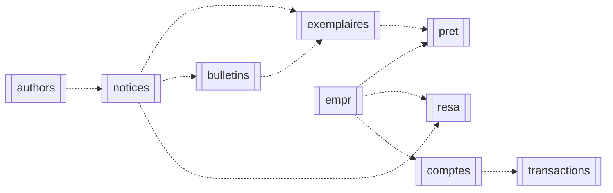

# RELATIONS_SQL — PMB Fourmies

Aucune contrainte FOREIGN KEY declaree dans l'export (MyISAM) : statut OBSERVE.
Tous les liens ci-dessous sont des HYPOTHESES de nommage a confirmer en local (coherence des valeurs + code PMB de la version). Cardinalites prudentes.
Legende Mermaid : `-.->` = lien suppose (jamais une contrainte etablie).

| source | cible | sens suppose | cardinalite prudente | preuve |
|---|---|---|---|---|
| `exemplaires.expl_notice` | `notices.notice_id` | exemplaire rattache a sa notice | a confirmer (unicites : voir dictionnaire) | nommage |
| `exemplaires.expl_bulletin` | `bulletins.bulletin_id` | exemplaire de bulletin (0 = notice directe) | a confirmer (unicites : voir dictionnaire) | nommage |
| `bulletins.bulletin_notice` | `notices.notice_id` | notice mere du periodique | a confirmer (unicites : voir dictionnaire) | nommage |
| `bulletins.num_notice` | `notices.notice_id` | notice de depouillement | a confirmer (unicites : voir dictionnaire) | nommage |
| `responsability.responsability_author` | `authors.author_id` | lien vers l'auteur | a confirmer (unicites : voir dictionnaire) | nommage |
| `responsability.responsability_notice` | `notices.notice_id` | lien vers la notice | a confirmer (unicites : voir dictionnaire) | nommage |
| `notices_categories.notcateg_notice` | `notices.notice_id` | categorie d'une notice | a confirmer (unicites : voir dictionnaire) | nommage |
| `notices_categories.num_noeud` | `categories.num_noeud` | noeud thesaurus (PK composite cote categories) | a confirmer (unicites : voir dictionnaire) | nommage |
| `notices.ed1_id / ed2_id` | `publishers.ed_id` | editeurs | a confirmer (unicites : voir dictionnaire) | nommage |
| `notices.coll_id` | `collections.collection_id` | collection | a confirmer (unicites : voir dictionnaire) | nommage |
| `notices.subcoll_id` | `sub_collections.sub_coll_id` | sous-collection | a confirmer (unicites : voir dictionnaire) | nommage |
| `notices.tparent_id` | `notices (auto-reference supposee).notice_id` | hierarchie (sens exact a confirmer) | a confirmer (unicites : voir dictionnaire) | nommage |
| `pret.pret_idexpl` | `exemplaires.expl_id` | un seul pret en cours par exemplaire (PK observee) | a confirmer (unicites : voir dictionnaire) | nommage |
| `pret.pret_idempr` | `empr.id_empr` | emprunteur du pret en cours | a confirmer (unicites : voir dictionnaire) | nommage |
| `resa.resa_idempr` | `empr.id_empr` | demandeur | a confirmer (unicites : voir dictionnaire) | nommage |
| `resa.resa_idnotice` | `notices.notice_id` | notice reservee | a confirmer (unicites : voir dictionnaire) | nommage |
| `resa.resa_idbulletin` | `bulletins.bulletin_id` | bulletin reserve | a confirmer (unicites : voir dictionnaire) | nommage |
| `empr.empr_categ` | `empr_categ.id_categ_empr` | categorie (dont 2 = Collectivite / comptes pro) | a confirmer (unicites : voir dictionnaire) | nommage |
| `empr.empr_codestat` | `empr_codestat.idcode` | code statistique | a confirmer (unicites : voir dictionnaire) | nommage |
| `empr.empr_statut` | `empr_statut.idstatut` | statut de fiche | a confirmer (unicites : voir dictionnaire) | nommage |
| `empr.empr_location` | `docs_location.idlocation` | site de rattachement | a confirmer (unicites : voir dictionnaire) | nommage |
| `exemplaires.expl_typdoc` | `docs_type.idtyp_doc` | type de document | a confirmer (unicites : voir dictionnaire) | nommage |
| `exemplaires.expl_section` | `docs_section.idsection` | section | a confirmer (unicites : voir dictionnaire) | nommage |
| `exemplaires.expl_statut` | `docs_statut.idstatut` | statut | a confirmer (unicites : voir dictionnaire) | nommage |
| `exemplaires.expl_location` | `docs_location.idlocation` | localisation | a confirmer (unicites : voir dictionnaire) | nommage |
| `exemplaires.expl_codestat` | `docs_codestat.idcode` | code statistique | a confirmer (unicites : voir dictionnaire) | nommage |
| `transactions.compte_id` | `comptes.id_compte` | compte mouvemente | a confirmer (unicites : voir dictionnaire) | nommage |
| `comptes.proprio_id` | `empr.id_empr` | proprietaire suppose du compte | a confirmer (unicites : voir dictionnaire) | nommage |
| `cache_amendes.id_empr` | `empr.id_empr` | amendes calculees de l'adherent | a confirmer (unicites : voir dictionnaire) | nommage |
| `log_retard.idempr` | `empr.id_empr` | adherent en retard | a confirmer (unicites : voir dictionnaire) | nommage |
| `recouvrements.empr_id / id_expl` | `empr / exemplaires.id_empr / expl_id` | contentieux | a confirmer (unicites : voir dictionnaire) | nommage |

Ordre de dependance propose pour un import : referentiels -> autorites -> notices -> bulletins -> exemplaires -> adherents -> circulation -> finance.
